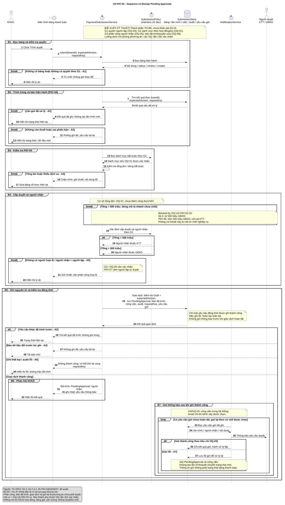

# US-PAY-02 – Đặc tả v2

[ĐẶC TẢ] là yêu cầu TA; [ĐỀ XUẤT KỸ THUẬT] là cách thực hiện. G1–G4 được dẫn chiếu đến các OQ tương ứng.

## Đặc tả Use Case

| Trường | Nội dung |
|---|---|
| Tên Use Case | US-PAY-02 – Trình duyệt bảng thanh toán, v2. Phạm vi: trình bảng; việc duyệt/từ chối thuộc US-PAY-03. [ĐẶC TẢ; TA-SPEC §4.2–4.3] |
| Tác nhân | NVKD thực hiện trình; KTT hoặc GĐKD nhận yêu cầu theo thẩm quyền. [ĐẶC TẢ; TA-SPEC §2; §4.2–4.3; §5 PAY-06] G1: chỉ NVKD lập bảng được trình; chưa mở chức năng trình thay. [OQ-US-PAY-02-04] |
| Mục tiêu | Đưa bảng hợp lệ Draft → PendingApproval và gửi thông báo cho người duyệt; ghi audit người thực hiện, thời điểm, thay đổi. [ĐẶC TẢ; TA-SPEC §3; §4.2; §6] G3 bổ sung giao việc cho người nhận cụ thể để bảng có người xử lý. [OQ-US-PAY-02-05] |
| Kích hoạt | NVKD mở bảng và chọn “Trình duyệt”. [ĐẶC TẢ; TA-SPEC §4.2] Giao diện gửi mã bảng, phiên bản đang xem và khóa nhận diện lần gửi. [ĐỀ XUẤT KỸ THUẬT; PAY-04; OQ-US-PAY-02-06] |
| Tiền điều kiện | Bảng đã được lập và đang ở Draft; người thực hiện là NVKD. [ĐẶC TẢ; TA-SPEC §2–3; §4.1–4.2] Kiểm tra quyền theo G1 và phiên bản hiện hành tại thời điểm xử lý. [G1; ĐỀ XUẤT KỸ THUẬT; OQ-04/06] Các kiểm tra PAY-04 thực hiện trong luồng, không coi là đã đạt. Nhánh phụ thuộc chính sách còn mở vẫn Blocked by OQ tương ứng. |
| Dòng cơ bản | B1. NVKD chọn Trình duyệt; hệ thống đọc bản hiện hành và kiểm tra quyền theo G1. [ĐẶC TẢ §4.2; G1/OQ-04; ĐỀ XUẤT KỸ THUẬT] B2. Kiểm tra lần gửi đã xử lý hay chưa, trạng thái Draft và phiên bản đang xem. Yêu cầu lặp trả kết quả hiện có, không tạo thêm lần trình. [PAY-04; ĐỀ XUẤT KỸ THUẬT] B3. Kiểm tra tổng tiền âm, thiếu dòng dịch vụ bắt buộc theo PAY-04. G2 đề xuất xác định danh mục theo hợp đồng/kỳ. Danh mục cụ thể Blocked by OQ-01. [ĐẶC TẢ §5 PAY-04; G2] B4. Xác định cấp và người nhận duyệt trên tổng tiền của bản đang trình: dưới 500 triệu KTT, trên 500 triệu GĐKD. Đúng 500 triệu Blocked by OQ-02; cơ sở tổng tiền Blocked by OQ-07. G3 đề xuất chặn hoàn tất nếu không có người nhận hợp lệ hoặc người nhận là người lập; chưa tự chuyển cấp. [ĐẶC TẢ §4.3; §5 PAY-06/07; G3/OQ-05] B5. Ghi một giao dịch: kiểm tra lại Draft/phiên bản, chuyển PendingApproval, ghi bản dữ liệu đã trình, giao việc theo G3, audit và yêu cầu thông báo. Chỉ hoàn tất nếu toàn bộ ghi thành công. [ĐẶC TẢ §4.2, §6; ĐỀ XUẤT KỸ THUẬT; OQ-05/06] B6. Trả kết quả đã trình, trạng thái PendingApproval và người nhận. Chỉ báo đã ghi nhận yêu cầu thông báo ở thời điểm này. [ĐỀ XUẤT KỸ THUẬT; §4.2] B7. Bộ gửi thông báo đọc yêu cầu đã ghi và gửi đến người nhận. G4 đề xuất danh sách chờ duyệt trong hệ thống là nơi xử lý chính; email bổ sung nếu được chọn. [ĐẶC TẢ §4.2; G4/OQ-03] |
| Dòng thay thế | A1 (B1): Không tồn tại bảng hoặc không có quyền theo G1: trả lý do, không ghi thay đổi. [ĐỀ XUẤT KỸ THUẬT; OQ-04] A2 (B2/B5): Trình trùng, kể cả đồng thời: chỉ một lần chuyển trạng thái; yêu cầu còn lại nhận kết quả đã trình. [ĐẶC TẢ PAY-04; ĐỀ XUẤT KỸ THUẬT] A3 (B2/B5): Không còn Draft hoặc phiên bản đã thay đổi: không ghi đè; yêu cầu tải lại. [ĐỀ XUẤT KỸ THUẬT; §3; OQ-06] A4 (B3): Tổng âm hoặc thiếu dịch vụ bắt buộc: chặn trình, giữ Draft, chỉ rõ lỗi. [ĐẶC TẢ PAY-04; phản hồi là ĐỀ XUẤT KỸ THUẬT; OQ-01] A5 (B4): Không xác định người nhận hợp lệ: xử lý theo G3; giữ Draft, báo cần phân công. [OQ-05; PAY-07] A6 (B5): Ghi dữ liệu/giao việc/audit/yêu cầu thông báo lỗi: hoàn tác giao dịch, không thông báo thành công; cho thử lại cùng khóa lần gửi. [ĐỀ XUẤT KỸ THUẬT; PAY-04, §6] A7 (B7): Gửi thông báo lỗi sau khi đã ghi thành công: giữ PendingApproval và công việc; lưu lỗi gửi để gửi lại, không yêu cầu NVKD trình lại. [ĐỀ XUẤT KỸ THUẬT; G4/OQ-03] |

## Hậu điều kiện và ranh giới

Thành công: có lần trình được ghi, bảng PendingApproval và audit; công việc/yêu cầu thông báo theo các đề xuất B5–B7. Thất bại trước khi ghi: không có lần trình mới. Yêu cầu lặp không tạo thêm audit chuyển trạng thái hoặc công việc cho cùng lần trình. [TA-SPEC §4.2; §5 PAY-04; §6; ĐỀ XUẤT KỸ THUẬT]
Luồng B3–B5 không tự thay đổi sản lượng/đơn giá của bảng đang trình. Ghi lại bản dữ liệu dùng trình; quyền sửa PendingApproval còn Blocked by OQ-06. Chưa bổ sung thu hồi, ủy quyền, nhắc hạn hoặc tự nâng cấp duyệt. [TA-SPEC §4.1–4.2; §5 PAY-03; ĐỀ XUẤT KỸ THUẬT]
Thời gian ≤3 giây với <200 dòng ở §6 thuộc chức năng lập bảng; không gán thành SLA trình duyệt. Không mở rộng CRUD hợp đồng/bảng giá/sản lượng. [ĐẶC TẢ; TA-SPEC §1; §6]

## Các Open Questions còn mở

ID đầy đủ có tiền tố OQ-US-PAY-02-. Các mã OQ-01..07 trong v2/sequence là cách viết ngắn của đúng các ID này. Tất cả: Đang mở; người/ngày/câu trả lời và tham chiếu: Chưa có.

01 | Thiếu | TA-SPEC §5 PAY-04: chưa có danh mục dịch vụ bắt buộc. Cần danh mục để kiểm tra B3/A4; lựa chọn danh mục chung hoặc theo hợp đồng/kỳ (G2), chưa chọn chính thức. Ảnh hưởng validation và dữ liệu kiểm chứng.

02 | Mâu thuẫn | TA-SPEC §4.3 (từ 500 triệu GĐKD) ↔ §5 PAY-06 (trên 500 triệu GĐKD, còn lại KTT). Cần xác định người duyệt đúng 500.000.000 đồng; lựa chọn theo một trong hai phía sau xác nhận. Ảnh hưởng B4, không tự chọn >= hay > trong sequence.

03 | Thiếu | TA-SPEC §4.2: kênh và tiêu chí gửi thành công chưa rõ. Cần chốt để hoàn thiện B7/A7; lựa chọn chỉ trong hệ thống hoặc kèm email (G4), và cách gửi lại khi lỗi. Ảnh hưởng thông báo và phản hồi kết quả.

04 | Thiếu | TA-SPEC §2; §4.2: NVKD nào được trình? Cần giới hạn trách nhiệm; lựa chọn chỉ người lập (G1) hoặc NVKD khác có quyền. Ảnh hưởng B1 và kiểm tra quyền.

05 | Thiếu | TA-SPEC §4.2–4.3; §5 PAY-06/07: chưa rõ cá nhân/nhóm nhận và cách xử lý khi thiếu người nhận hoặc trùng người lập. Cần tránh bảng chờ không người xử lý/tự duyệt; lựa chọn giao cá nhân, nhóm có trách nhiệm hoặc phương án được xác nhận; G3 mô phỏng giao cá nhân và chặn khi không hợp lệ. Ảnh hưởng B4–B5/A5.

06 | Thiếu | TA-SPEC §3; §4.1–4.2; §5 PAY-03: chưa rõ nội dung/phiên bản được trình và quyền sửa khi PendingApproval. Cần bảo đảm người duyệt xem đúng nội dung; lựa chọn giữ nguyên bản trình hoặc cho sửa với quy trình duyệt lại. v2 mô phỏng giữ bản đã trình. Ảnh hưởng B2/B5, dữ liệu và xử lý đồng thời.

07 | Mơ hồ | TA-SPEC §4.3; §5 PAY-06: cơ sở tổng tiền phân cấp duyệt chưa chi tiết, ví dụ có gồm thuế hay không. Cần chính sách tổng tiền duy nhất; lựa chọn do người phụ trách xác nhận, chưa thêm công thức/VAT. Ảnh hưởng B4.

## Quyết định kỹ thuật được đề xuất

T1 – Chống gửi trùng/đồng thời: kết hợp khóa lần gửi với kiểm tra Draft và phiên bản khi ghi; mục đích chỉ tạo một lần trình, theo PAY-04. Chỉ khóa nút là phương án đơn giản hơn nhưng không chặn yêu cầu từ hai cửa sổ. Khóa gắn một lần trình/bản dữ liệu; không khóa vĩnh viễn mã bảng. Lần trình sau phải có định danh mới khi luồng nghiệp vụ cho phép. [TA-SPEC §4.2; §5 PAY-04; OQ-06]

T2 – Ghi nhất quán: cùng giao dịch lưu PendingApproval, bản đã trình, công việc, audit và yêu cầu thông báo; mục đích tránh thiếu audit/mất việc. Ghi từng phần đơn giản hơn nhưng có thể để dữ liệu dở dang. Đề xuất một CSDL cho quy mô bài tập; không cần thêm broker/dịch vụ phân tán. Đây là thiết kế TO-BE, chưa khảo sát hay xác nhận thành phần AS-IS. [TA-SPEC §4.2; §6; OQ-05/06]

T3 – Thông báo: lưu yêu cầu gửi cùng giao dịch, bộ gửi xử lý sau và gửi lại khi lỗi. Mục đích không mất thông báo hoặc trình trùng khi gửi lỗi. Gửi đồng bộ trực tiếp là phương án khác nhưng có rủi ro dữ liệu đã lưu, gửi chưa thành công. Trạng thái xử lý thông báo tách khỏi trạng thái bảng; không thêm trạng thái bảng thanh toán. [TA-SPEC §4.2; §3; OQ-03]

T4 – Dữ liệu đã trình: dùng giá trị đã lưu và giữ bản dữ liệu tại B5, kiểm tra phiên bản để tránh ghi đè. Đọc dữ liệu sống rồi tự tính lại là phương án khác nhưng có thể đổi nội dung NVKD đang trình. Không tự chốt quyền sửa PendingApproval khi OQ-06 còn mở. [TA-SPEC §4.1–4.2; §5 PAY-03]

## Sequence và truy vết

v2: sequence-us-pay-02-v2.puml mô tả B1–B7/A1–A7. PaymentSubmissionService, SubmissionPolicy, SubmissionStore và NotificationService là lifeline ĐỀ XUẤT KỸ THUẬT, không tuyên bố đã tồn tại trong src/.

Truy vết: §4.2 → B1/B5/B7; PAY-04 → B2/B3/B5, A2–A4; PAY-06/07 → B4/A5; §6 audit → B5/A6. OQ-01/04/05/06/07 và các G1–G4 xuất hiện tại vị trí phụ thuộc trong sequence. Nhánh đúng 500 triệu ghi Blocked by OQ-02.

Nguồn nghiệp vụ: TA-SPEC tại docs/requirements/payment-management/spec.md; chưa mở TA-PDF trong lần này. Tài liệu Microsoft/AWS đã tra ở lượt trước chỉ là THAM KHẢO cho đề xuất, không giải quyết OQ. Không bổ sung User Story/Acceptance Criteria theo yêu cầu đã bỏ.

## Tệp sequence và kiểm chứng

- [Sequence v2 – PlantUML](diagrams/sequence-us-pay-02-v2.puml)
- [Sequence v2 – SVG có thể phóng to](diagrams/sequence-us-pay-02-v2.svg)
- [Sequence v2 – PNG](diagrams/sequence-us-pay-02-v2.png)

Các OQ được theo dõi tại mục Open Questions. Kiểm tra cú pháp/kết xuất chỉ kiểm chứng sơ đồ.

Đã kiểm tra ngày 07/11/2026:

- PlantUML 1.2026.9; Temurin JRE 21.0.13+9, chạy từ thư mục tạm; không cài vào hệ thống.
- Kiểm tra cú pháp với -checkonly, kết xuất -tsvg và -tpng: cả ba mã thoát 0.
- Đã mở ảnh PNG cuối: 1715 × 3036 pixel; SVG 1716 × 3037 pixel. Hiển thị đủ B1–B7, A1–A7 và chú giải, không bị cắt phần cuối.
- Đã đối chiếu nhãn B1–B7/A1–A7 giữa spec và mã PlantUML; kiểm tra liên kết tệp đều tồn tại.
- Đã so sánh các ô của v1 với bản gốc đã đọc: giữ nguyên. Chỉ có sequence v2 theo yêu cầu cuối.

Nhật ký prompt, nguồn, công cụ và lệnh thực tế: [prompt-log.md](../../workflow/prompt-log.md), mục PAY-02-V2-04.
