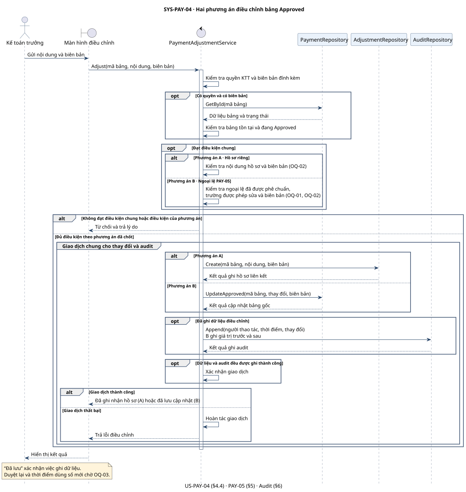

# SYS-PAY-04 — Điều chỉnh bảng thanh toán đã duyệt

**Before Review · Phụ trách Lộc**

Bản chuẩn bị review này được sắp xếp lại từ thiết kế đã trao đổi. Các luồng A/B là phương án đề xuất và còn chờ khách hàng xác nhận.

US-PAY-04 (§4.4) cho phép Kế toán trưởng điều chỉnh bảng `Approved` khi có biên bản xác nhận. PAY-05 (§5) cấm sửa bảng `Approved`. Hai điều khoản xung đột nếu điều chỉnh được thực hiện bằng cách ghi đè bảng gốc. System Spec dưới đây tách phần đặc tả đã nêu khỏi hai phương án đề xuất để review. [Đặc tả gốc](../../../requirements/payment-management/spec.md)

## System Spec

| Mục | Đặc tả |
|---|---|
| **Tên Use Case** | **SYS-PAY-04 — Điều chỉnh bảng thanh toán đã duyệt** |
| **Tác nhân** | Kế toán trưởng (KTT). |
| **Mục tiêu** | Ghi nhận việc điều chỉnh sai sót sau khi duyệt, kèm biên bản xác nhận và lịch sử thay đổi. |
| **Kích hoạt** | KTT phát hiện sai sót trên bảng đã duyệt và gửi nội dung điều chỉnh cùng biên bản. |
| **Tiền điều kiện** | Người thao tác có quyền KTT. Bảng tồn tại và đang ở `Approved`. Có biên bản xác nhận đính kèm. |
| **Hậu điều kiện** | **A:** Hồ sơ điều chỉnh được lưu và liên kết với bảng gốc. Số liệu và trạng thái `Approved` của bảng gốc được giữ nguyên. **B:** Khi đủ điều kiện ngoại lệ, các trường được phép trên bảng gốc được cập nhật và liên kết với biên bản. Cả hai phương án đều ghi audit. Kết quả “đã lưu” chỉ xác nhận việc ghi dữ liệu. Việc duyệt lại, trạng thái của bảng sau khi điều chỉnh theo B và thời điểm kế toán dùng số mới chờ OQ-03. |
| **Dòng cơ bản** | **1.** KTT chọn bảng và gửi nội dung điều chỉnh cùng biên bản. **2.** Hệ thống kiểm tra quyền KTT, bảng `Approved` và biên bản đính kèm. **3.** Hệ thống kiểm tra theo phương án triển khai đã được chốt. Với **A**, kiểm tra nội dung hồ sơ và biên bản theo tiêu chí sẽ xác nhận ở OQ-02. Với **B**, kiểm tra ngoại lệ PAY-05 đã được phê chuẩn, phạm vi trường được sửa và biên bản theo tiêu chí đã chốt. **4.** Hệ thống lưu hồ sơ liên kết ở A hoặc cập nhật bảng gốc ở B, sau đó ghi audit trong cùng giao dịch. **5.** Khi giao dịch thành công, hệ thống trả kết quả đã ghi nhận hồ sơ (A) hoặc đã lưu cập nhật (B). |
| **Dòng thay thế** | **2a.** Sai quyền, bảng không tồn tại, bảng chưa `Approved` hoặc thiếu biên bản. Hệ thống từ chối và báo lý do. **3a.** Nội dung hoặc biên bản không đạt tiêu chí đã chốt, hoặc B chưa có ngoại lệ hợp lệ. Hệ thống từ chối và báo lý do. **4a.** Giao dịch thất bại, gồm trường hợp lỗi khi ghi dữ liệu hoặc audit. Hệ thống hoàn tác và báo lỗi. |
| **Yêu cầu phi chức năng** | **Theo §6:** Ghi audit cho mọi điều chỉnh và mọi thay đổi trạng thái, gồm ai thao tác, lúc nào và thay đổi gì. **Đề xuất kỹ thuật:** Lưu thay đổi và audit trong cùng giao dịch. Với B, ghi giá trị trước và sau cho các trường đã cập nhật. |

## Hai phương án xử lý bảng `Approved`

| Phương án | Cách xử lý | Điều kiện và điểm đánh đổi |
|---|---|---|
| **A · Lập hồ sơ điều chỉnh riêng** | `AdjustmentRepository` lưu mã bảng gốc, nội dung điều chỉnh và biên bản trong hồ sơ riêng. Bảng gốc vẫn `Approved` và giữ số liệu đã duyệt. | Tuân thủ PAY-05. Cần chốt tiêu chí chấp nhận hồ sơ và thời điểm dùng số điều chỉnh. |
| **B · Sửa bảng gốc theo ngoại lệ** | `PaymentRepository` cập nhật các trường được phép trên bảng gốc và lưu tham chiếu biên bản. Audit lưu giá trị trước và sau. | Cần xác nhận ngoại lệ PAY-05 và giới hạn trường được sửa. Khách hàng cần chốt quy tắc duyệt lại và cách xử lý số liệu đã chuyển sang kế toán. |

Các quyết định còn mở được ghi trong [Điểm cần kiểm tra lại trong đề](us-pay-04-issues.md).

## Sequence Diagram

`PaymentAdjustmentService` kiểm tra điều kiện và điều phối giao dịch. Hai nhánh A/B biểu diễn hai thiết kế để khách hàng chọn. `AuditRepository` ghi lịch sử cho phương án được triển khai.

[Nguồn PlantUML](us-pay-04-before-review-sequence.puml)
