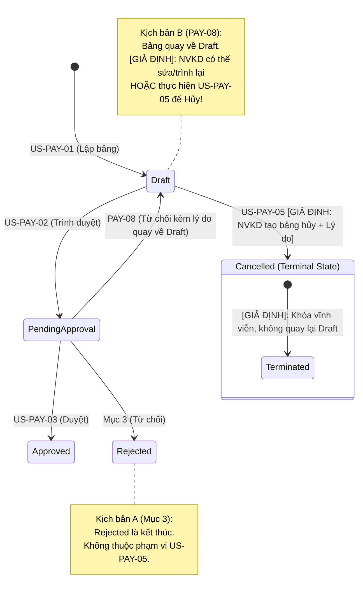

# Phân tích Yêu cầu Nghiệp vụ: US-PAY-05 (Hủy bảng nháp)

> **Căn cứ tài liệu gốc:** [`docs/requirements/payment-management/spec.md`](file:///d:/DaiHoc/HK1 26-27/PhatTrienUngDungHTTTHienDai/Assignment/Week05/03-QTKD-Seminar/docs/requirements/payment-management/spec.md)  
> **Quy tắc áp dụng:** [`.agents/rules/qtkd-context.md`](file:///d:/DaiHoc/HK1 26-27/PhatTrienUngDungHTTTHienDai/Assignment/Week05/03-QTKD-Seminar/.agents/rules/qtkd-context.md) và [`.agents/rules/payment-management.md`](file:///d:/DaiHoc/HK1 26-27/PhatTrienUngDungHTTTHienDai/Assignment/Week05/03-QTKD-Seminar/.agents/rules/payment-management.md)  
> **Báo cáo Review đối chiếu:** [`docs/review/payment-management/ai-review-1.md`](file:///d:/DaiHoc/HK1 26-27/PhatTrienUngDungHTTTHienDai/Assignment/Week05/03-QTKD-Seminar/docs/review/payment-management/ai-review-1.md)  
> **Mã User Story:** `US-PAY-05`  
> **Mã Use Case:** `UC-PAY-05`  
> **Trạng thái:** `Bản cập nhật sau Review Lần 1 (Gắn nhãn Giả định thiết kế - Chờ xác nhận)`

---

## 1. Trích dẫn nguyên văn từ Đặc tả gốc (`spec.md`)

* **Mục 1 (Mục đích và phạm vi):**  
  > *"Module này chỉ bao gồm: lập, trình duyệt, duyệt/từ chối, điều chỉnh và hủy bảng thanh toán. Quản lý hợp đồng, bảng giá và sản lượng là module khác; module này chỉ đọc dữ liệu từ chúng."*
* **Mục 3 (Trạng thái bảng thanh toán):**  
  > *"Bảng thanh toán có các trạng thái: Draft, PendingApproval, Approved, Rejected, Cancelled.*  
  > *Luồng chính: Draft → PendingApproval → Approved. Khi bị từ chối, bảng chuyển sang Rejected. Draft có thể chuyển sang Cancelled."*
* **Mục 4.5 (US-PAY-05: Hủy bảng nháp):**  
  > *"Bảng ở trạng thái Draft có thể bị hủy khi không còn cần thiết. Sau khi hủy, bảng chuyển sang Cancelled và không dùng lại được."*
* **Mục 5 (Quy tắc nghiệp vụ liên quan):**  
  > - **PAY-01:** *"Chỉ lập bảng thanh toán cho hợp đồng đang hiệu lực (Active) và có bảng giá phù hợp. Mỗi hợp đồng chỉ có một bảng thanh toán cho mỗi tháng."*  
  > - **PAY-08:** *"Khi từ chối phải nhập lý do; sau khi bị từ chối, bảng quay về trạng thái Draft để NVKD chỉnh sửa và trình lại."*
* **Mục 6 (Yêu cầu phi chức năng liên quan):**  
  > *"Mọi thay đổi trạng thái và mọi điều chỉnh phải được ghi audit log (ai, lúc nào, thay đổi gì)."*

---

## 2. Bảng Open Questions & Các Giả định Thiết kế (`[GIẢ ĐỊNH – Cần xác nhận]`)

Tuân thủ nghiêm ngặt quy tắc [`.agents/rules/payment-management.md`](file:///d:/DaiHoc/HK1 26-27/PhatTrienUngDungHTTTHienDai/Assignment/Week05/03-QTKD-Seminar/.agents/rules/payment-management.md), mọi điểm mâu thuẫn, mơ hồ hoặc thiếu trong đặc tả gốc **không được tự ý quyết định hay triệt tiêu**, mà phải ghi nhận đầy đủ vào bảng dưới đây. Các phương án tạm chọn để triển khai thiết kế đều được gắn nhãn `[GIẢ ĐỊNH – Cần xác nhận]`:

| ID | Vị trí trong đặc tả | Loại vấn đề | Mô tả chi tiết vấn đề | Phân tích các kịch bản | Đề xuất thiết kế tạm thời (`[GIẢ ĐỊNH – Cần xác nhận]`) |
|---|---|---|---|---|---|
| **OQ-PAY05-01** | Mục 3 so với PAY-08 và Mục 4.5 | **Mâu thuẫn** | **Trạng thái sau khi bị từ chối và quyền Hủy bảng:** - *Mục 3:* Bị từ chối chuyển sang `Rejected`. - *PAY-08:* Bị từ chối quay về trạng thái `Draft` để NVKD chỉnh sửa và trình lại. | - **Kịch bản A (Theo Mục 3):** Bảng chuyển sang `Rejected`. Vì mục 4.5 chỉ quy định *"Bảng ở trạng thái Draft có thể bị hủy"*, bảng `Rejected` sẽ không thuộc phạm vi hủy của US-PAY-05 (hoặc trở thành trạng thái kết thúc). - **Kịch bản B (Theo PAY-08):** Bảng quay về `Draft`. Khi đã là `Draft`, NVKD phát hiện số liệu sai hoàn toàn không thể sửa được nữa thì có được quyền dùng US-PAY-05 để Hủy không? | `[GIẢ ĐỊNH – Cần xác nhận]` 1. Cần xác nhận từ PO/Giảng viên xem trạng thái sau từ chối là `Rejected` hay quay về `Draft`. 2. *Giả định thiết kế:* Nếu hệ thống vận hành theo PAY-08 (quay về `Draft`), NVKD **được phép thực hiện US-PAY-05 để hủy bảng nháp này** nếu không có nhu cầu sửa và trình lại. Nếu vận hành theo Mục 3 (`Rejected`), bảng `Rejected` đóng lại vĩnh viễn không được hủy. |
| **OQ-PAY05-02** | Mục 4.5 so với Mục 4.1, 4.2 | **Thiếu** | **Thiếu Actor thực hiện hủy:** Mục 4.1 và 4.2 ghi rõ `(NVKD)`, 4.4 ghi rõ `(KTT)`. Riêng 4.5 dùng câu bị động: *"Bảng ở trạng thái Draft có thể bị hủy khi không còn cần thiết"*, không định danh ai được hủy. | - Ai được phép hủy: Chỉ NVKD tạo bảng, hay bất kỳ NVKD nào, hay cấp quản lý (Trưởng phòng/Admin)? - Rủi ro: Nếu quy định cứng chỉ người tạo mới được hủy, khi NVKD đó nghỉ việc hoặc chuyển công tác thì ai sẽ hủy bảng nháp đó? | `[GIẢ ĐỊNH – Cần xác nhận]` Tạm thời phân quyền: Chỉ **NVKD tạo bảng (`CurrentUser.Id == PaymentSheet.CreatedBy`)** mới có quyền hủy nhằm đảm bảo tính toàn vẹn dữ liệu. Bổ sung giả định mở rộng: Cấp Quản trị viên/Trưởng phòng có thể được cấu hình quyền can thiệp khi có biên bản bàn giao. |
| **OQ-PAY05-03** | Mục 4.5 so với PAY-08 | **Thiếu** | **Quy định về Lý do hủy:** Mục 4.5 chỉ ghi *"khi không còn cần thiết"*. PAY-08 quy định khi Từ chối phải nhập lý do, nhưng 4.5 không nói rõ khi Hủy có bắt buộc nhập lý do hay không. | - Nếu không bắt buộc: Tiện lợi cho người dùng nhưng thiếu thông tin đối soát cho kiểm toán. - Nếu bắt buộc: Phải có trường `reason` trong Request Body và kiểm tra validation. | `[GIẢ ĐỊNH – Cần xác nhận]` Thiết kế theo hướng chặt chẽ: **Bắt buộc nhập lý do hủy** (`CancelReason` không rỗng) để lưu vào bản ghi bảng thanh toán và Audit Log theo NFR Mục 6. |
| **OQ-PAY05-04** | Mục 4.5 so với PAY-01 | **Mơ hồ / Mâu thuẫn** | **Ý nghĩa "không dùng lại được" và ràng buộc 1 bảng/kỳ:** - *PAY-01:* "Mỗi hợp đồng chỉ có một bảng thanh toán cho mỗi tháng." - *Mục 4.5:* "Sau khi hủy, bảng chuyển sang Cancelled và không dùng lại được." | - Diễn giải 1: Bảng cũ bị hủy vĩnh viễn không mở lại được, và kỳ tháng đó được phép lập bảng mới thay thế. - Diễn giải 2: Nguyên văn PAY-01 không có chữ "hoạt động". Liệu việc hủy bảng có làm mất luôn quyền lập bảng của tháng đó hay không? | `[GIẢ ĐỊNH – Cần xác nhận]` Tạm giả định theo hướng nghiệp vụ thực tế (Diễn giải 1): Sau khi hủy bảng nháp, NVKD **được phép lập bảng thanh toán mới thay thế** cho cùng hợp đồng và kỳ đó. DB Constraint áp dụng Filtered Index: `WHERE Status <> 'Cancelled'`. |
| **OQ-PAY05-05** | Mục 4.5 so với Mục 6 | **Mơ hồ** | **Hình thức lưu trữ và hiển thị của bảng `Cancelled`:** Đặc tả không nói bảng bị hủy có hiển thị trên danh sách bảng thanh toán hay không. | - Nếu ẩn: Người dùng có thể hiểu nhầm là đã xóa mất dữ liệu. - Nếu hiển thị: Cần nhãn trạng thái và bộ lọc trạng thái. | `[GIẢ ĐỊNH – Cần xác nhận]` Lưu trữ Soft State (cập nhật trạng thái `Cancelled`, giữ nguyên các dòng chi tiết) và **vẫn hiển thị trên danh sách bảng thanh toán** kèm nhãn `Cancelled` để phục vụ tra cứu lịch sử. |
| **OQ-PAY05-06** | Mục 4.5 so với Mục 6 | **Thiếu** | **Xử lý xung đột đồng thời và lỗi giao dịch:** Đặc tả không mô tả chi tiết kỹ thuật về race condition và sự cố khi ghi log. | - Xung đột: Một người bấm Trình duyệt trong khi người khác bấm Hủy. - Sự cố: Ghi đổi trạng thái thành công nhưng ghi Audit Log thất bại thì dữ liệu xử lý ra sao? | `[GIẢ ĐỊNH – Cần xác nhận]` 1. Kiểm soát đồng thời bằng **Optimistic Concurrency Control (`RowVersion`)** thực thi tại tầng DB. 2. Cập nhật trạng thái và ghi Audit Log nằm trong cùng **Transaction**, nếu có lỗi thì **Rollback** toàn bộ. |

---

## 3. Phân tích Vòng đời Trạng thái & Vị trí US-PAY-05 (Bao gồm các Kịch bản)

---

## 4. Đặc tả luồng xử lý chi tiết cho US-PAY-05

| Thuộc tính | Chi tiết phân tích | Ghi chú & Căn cứ |
|---|---|---|
| **Mã User Story** | `US-PAY-05` | `spec.md`, Mục 4.5 |
| **Actor** | NVKD đã tạo bảng thanh toán đó | `[GIẢ ĐỊNH – Cần xác nhận]` (Xem OQ-PAY05-02) |
| **Tiền điều kiện** | 1. Bảng thanh toán tồn tại trong hệ thống. 2. Bảng thanh toán đang ở trạng thái `Draft` (kể cả bảng `Draft` do mới tạo theo US-PAY-01 hoặc bảng `Draft` do bị từ chối duyệt quay về theo PAY-08). 3. Người thực hiện chính là người đã tạo bảng (`CurrentUser.Id == PaymentSheet.CreatedBy`). | `spec.md`, Mục 3, 4.5 & `[GIẢ ĐỊNH]` |
| **Kích hoạt** | NVKD nhấn nút "Hủy bảng thanh toán" trên giao diện chi tiết hoặc danh sách. | `spec.md`, Mục 4.5 |
| **Dữ liệu đầu vào** | - `id`: Mã bảng thanh toán cần hủy. - `reason`: Lý do hủy (chuỗi ký tự không rỗng). - `rowVersion`: Token phiên bản kiểm soát đồng thời. | `[GIẢ ĐỊNH – Cần xác nhận]` (Xem OQ-PAY05-03, OQ-PAY05-06) |
| **Hậu điều kiện** | 1. Trạng thái của bảng chuyển thành `Cancelled`. 2. Bảng bị khóa vĩnh viễn, không thể chỉnh sửa hay phục hồi về `Draft`. 3. Bản ghi Audit Log được tạo thành công ghi nhận đầy đủ thông tin. 4. Bảng `Cancelled` vẫn hiển thị trên danh sách kèm nhãn tương ứng. 5. Cho phép lập bảng mới cho kỳ đó nếu cần. | `spec.md`, Mục 3, 4.5, 6 & `[GIẢ ĐỊNH]` |
