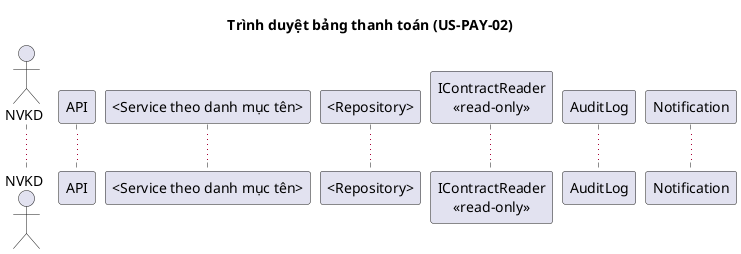

# Skill: sequence-diagram – Sequence theo thao tác

Vai trò: **design** trong [AGENTS.md](../../AGENTS.md). Đọc AGENTS.md và
[ngữ cảnh dùng chung](../_shared/payment-context.md).

## Đầu vào

- TA-SPEC; `sys-pay-0N-*.md` tương ứng (dòng cơ bản/thay thế là khung chính của
  sequence; thiếu thì ghi "chưa có đặc tả SYS" và dựa trực tiếp TA-SPEC).
- Danh mục tên trong `03-detailed-design.md`, `class.puml`, `04-api-contract.md`
  nếu có – message phải dùng đúng tên method/endpoint ở đó.

## Đầu ra

Một file mỗi thao tác trong `docs/design/payment-management/diagrams/`:

| File | Thao tác | US/PAY chính |
|---|---|---|
| `sequence-01-create.puml` | Lập bảng (sinh dòng, tổng tiền, Draft) | US-PAY-01; PAY-01, 02, 03; NFR-PAY-02 |
| `sequence-01b-update-draft.puml` | Sửa bảng Draft | US-PAY-01 (phạm vi sửa: OQ) |
| `sequence-02-submit.puml` | Trình duyệt | US-PAY-02; PAY-04, 06 |
| `sequence-03-approve.puml` | Duyệt | US-PAY-03; PAY-05, 06, 07 |
| `sequence-03b-reject.puml` | Từ chối | US-PAY-03; PAY-07, 08 |
| `sequence-04-adjust.puml` | Điều chỉnh Approved | US-PAY-04 ↔ PAY-05 – Blocked by OQ |
| `sequence-05-cancel.puml` | Hủy Draft | US-PAY-05 |

Ghi danh mục (file, mục đích, US/PAY/AC, OQ, trạng thái kết xuất) trong mục
"Sequence" của `03-detailed-design.md` – đây là danh mục liên kết AGENTS.md yêu cầu
khi tách sequence. Chỉ vẽ thao tác được giao nếu người dùng chỉ định.

## Khung mỗi file

Lifeline: actor đúng vai trò §2; module ngoài là interface chỉ đọc; không gọi
phương thức ghi tới hợp đồng/bảng giá/sản lượng.

## Nội dung bắt buộc

- **Kiểm tra phía server**: xác thực/vai trò, trạng thái hiện tại, quy tắc PAY –
  mỗi kiểm tra là một `alt` có nhánh lỗi trả mã HTTP/mã lỗi khớp `04-api-contract.md`.
- **Transaction**: `group Transaction` bao đổi trạng thái + ghi audit; nhánh
  `else lỗi lưu/audit` → rollback, trạng thái giữ nguyên (NFR-PAY-01).
- **Chống trình trùng (PAY-04)** ở submit: thể hiện cơ chế đã chọn trong
  `07-design-decisions.md` (Idempotency-Key, kiểm tra trạng thái có điều kiện/
  version, unique constraint…) gồm nhánh request lặp và hai request đồng thời.
  Chưa có DD thì ghi note `[ĐỀ XUẤT KỸ THUẬT]` + DD cần lập, không coi là đã chốt.
- **Cấm tự duyệt (PAY-07)** ở approve/reject: `alt actor là người lập` → từ chối;
  định nghĩa "người lập" ghi `Blocked by OQ-P03-04` nếu chưa trả lời.
- **Ngưỡng tiền (PAY-06)**: guard ghi theo OQ-P03-01, không viết so sánh đã chốt.
- **Reject**: lý do bắt buộc (PAY-08); trạng thái đích vẽ `alt` hai phương án
  với note `Blocked by OQ-P03-02`.
- **Adjust**: toàn bộ sơ đồ gắn banner `Blocked by OQ-P03-10`; nếu vẽ phương án
  (sửa trực tiếp / bản điều chỉnh) thì mỗi phương án một `alt` có nhãn giả định;
  có biên bản đính kèm và audit trước/sau.
- **Create**: `loop` sinh dòng từ sản lượng × đơn giá tại thời điểm tính (PAY-03);
  kiểm tra Active/bảng giá/đối soát (PAY-01, 02); kiểm tra trùng kỳ
  `Blocked by` OQ tháng/quý; note NFR-PAY-02 là mục tiêu, chưa đo.
- **Thông báo**: chỉ ở submit theo §4.2; kênh và các thông báo khác → `opt` + OQ.
- Mọi message đổi trạng thái kết thúc bằng ghi audit (ai, lúc nào, trước/sau).

## Kiểm chứng

- Mỗi dòng thay thế trong `sys-pay-0N-*.md` có một nhánh `alt/else` tương ứng
  (ghi bảng đối chiếu bước SYS ↔ đoạn sequence trong danh mục).
- Tên message = tên method/endpoint/event ở class, API, state machine.
- `@startuml`/`@enduml` cân bằng; kết xuất theo mục 7 ngữ cảnh dùng chung hoặc ghi
  `Chưa kiểm tra kết xuất sơ đồ`. Ghi prompt-log; không sửa `src/`.
