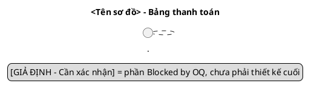

# Skill: uml-diagrams – Class, state machine, component

Vai trò: **design** trong [AGENTS.md](../../AGENTS.md). Đọc AGENTS.md và
[ngữ cảnh dùng chung](../_shared/payment-context.md). Sequence dùng skill
[sequence-diagram](../sequence-diagram/SKILL.md).

## Đầu vào

- TA-SPEC; đầu ra BA (`docs/analysis/payment-management/*`, gồm `sys-pay-*.md`);
  nếu chưa có thì ghi rõ "chưa có đầu ra BA", tự tóm tắt phần cần dùng.
- `docs/design/payment-management/03-detailed-design.md` mục "Danh mục tên dùng chung"
  (nếu có) và các `.puml` đã có – cập nhật, không tạo bản trùng.
- Đọc lại `src/Qtkd.Api/` trước khi vẽ thành phần AS-IS.

## Đầu ra

Trong `docs/design/payment-management/diagrams/`: `class.puml`,
`state-machine.puml`, `component.puml`; tùy chọn `use-case.puml`, `activity-*.puml`,
`erd.puml` (ERD do skill [data-design](../data-design/SKILL.md) quản lý).
Cập nhật danh mục sơ đồ trong `03-detailed-design.md` (hoặc `02` cho component):
tên file, mục đích, phạm vi, US/PAY, trạng thái kết xuất.

## Khung bắt buộc mỗi file

## State machine (`state-machine.puml`)

- Chỉ 5 trạng thái §3: `Draft`, `PendingApproval`, `Approved`, `Rejected`, `Cancelled`.
  Không thêm trạng thái (vd. Adjusted, Submitted, Deleted).
- Mỗi chuyển: `Nguồn --> Đích : event [guard] / action`, event trùng tên thao tác
  (submit/approve/reject/cancel/adjust…) trong danh mục tên.
- Chuyển có căn cứ rõ: `[*] --> Draft` (US-PAY-01), `Draft --> PendingApproval`
  (US-PAY-02, guard PAY-04), `PendingApproval --> Approved` (US-PAY-03, guard PAY-06/07),
  `Draft --> Cancelled` (§3, US-PAY-05), `Cancelled --> [*]`.
- Phần mâu thuẫn vẽ **cả hai phương án** với nét đứt/màu và note
  `Blocked by OQ-…`, không chọn: từ chối → `Rejected` (§3) vs → `Draft` (PAY-08);
  thoát khỏi `Rejected`; điều chỉnh trên `Approved` (§4.4 ↔ PAY-05).
- Mọi action đổi trạng thái có `/ ghi audit` (NFR-PAY-01).
- Guard ngưỡng tiền ghi theo OQ, không viết `>= 500tr` hoặc `> 500tr` như đã chốt.

## Class (`class.puml`)

- Lớp miền + service + interface; mỗi thuộc tính/phương thức có visibility
  (`+ - # ~`) và kiểu; quan hệ có multiplicity hai đầu (`"1" *-- "1..*"`).
- Composition cho bảng ↔ dòng; association có hướng tới audit; dependency
  (`..>`) tới interface đọc module khác.
- Module ngoài (hợp đồng, bảng giá, sản lượng) chỉ là `interface` chỉ đọc
  trong package riêng `<<external, read-only>>`; không vẽ phương thức ghi.
- Enum trạng thái đúng 5 giá trị §3. Không thêm lớp/abstraction không phục vụ
  US/PAY (vd. generic repository, plugin, cấu hình ngưỡng động) trừ khi có DD-kk.
- Thuộc tính phụ thuộc OQ (đơn vị kỳ, VAT, làm tròn, người được coi là "người lập")
  gắn note `Blocked by OQ-…`.
- Mỗi phương thức public của service ánh xạ một thao tác/endpoint trong danh mục tên.

## Component (`component.puml`)

- Ranh giới module Bảng thanh toán là `package`/`component`; giao diện cung cấp
  `()` và phụ thuộc `..>` tới interface đọc của Hợp đồng/Bảng giá/Sản lượng.
- Thể hiện thành phần audit, thông báo (kênh chưa rõ → note OQ), lưu trữ, xác thực.
- Đánh dấu `<<AS-IS>>` cho thành phần có thật trong `src/Qtkd.Api/` (đã đọc file),
  `<<TO-BE>>` cho thành phần đề xuất. Không vẽ thứ AS-IS chưa có như đã tồn tại.

## Use case / activity (chỉ khi cần)

Actor đúng 3 vai trò §2; use case đúng phạm vi §1 (không vẽ CRUD hợp đồng/bảng giá).

## Kiểm chứng

1. Chéo tên: mọi state/event/class/method xuất hiện trong danh mục tên;
   so với `04-api-contract.md`, `05-data-design.md`, sequence nếu đã có.
2. `grep -c "@startuml" diagrams/*.puml` = `grep -c "@enduml"`; mỗi file có `title`.
3. Kết xuất theo mục 7 của ngữ cảnh dùng chung; ghi lệnh + kết quả, hoặc
   `Chưa kiểm tra kết xuất sơ đồ`.
4. Ghi trạng thái `Design Pending Approval`; ghi prompt-log. Không sửa `src/`.
